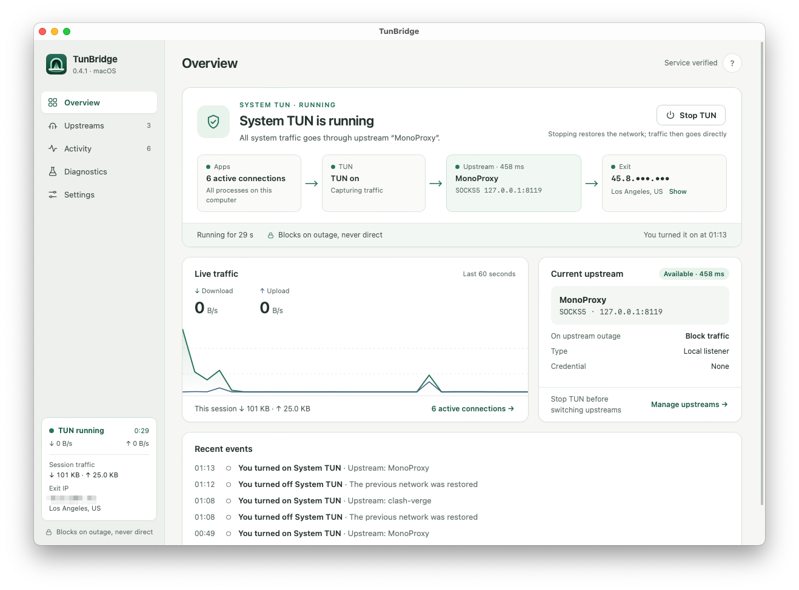
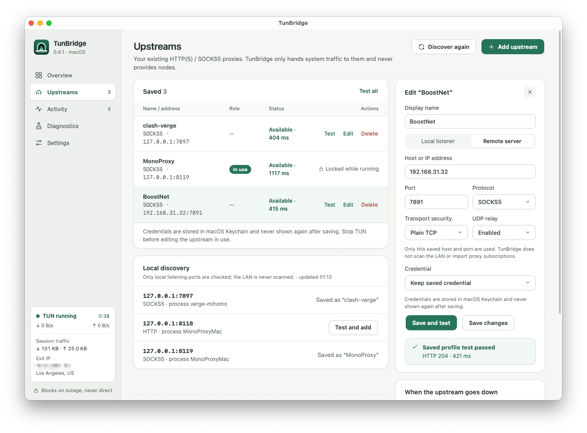
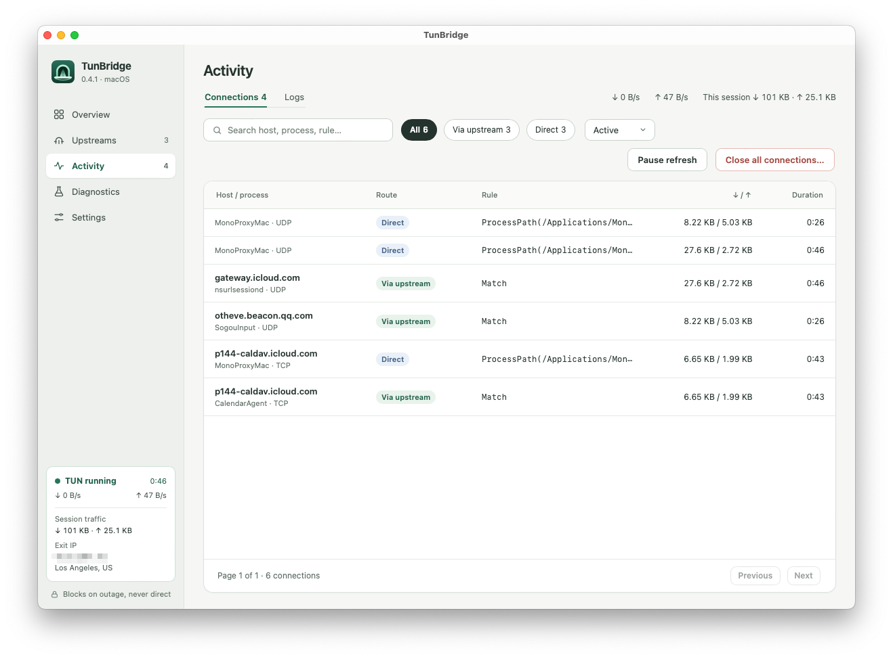
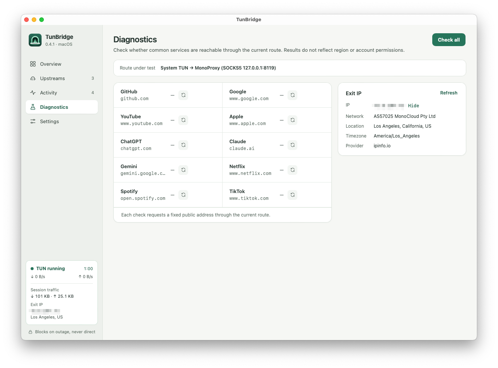
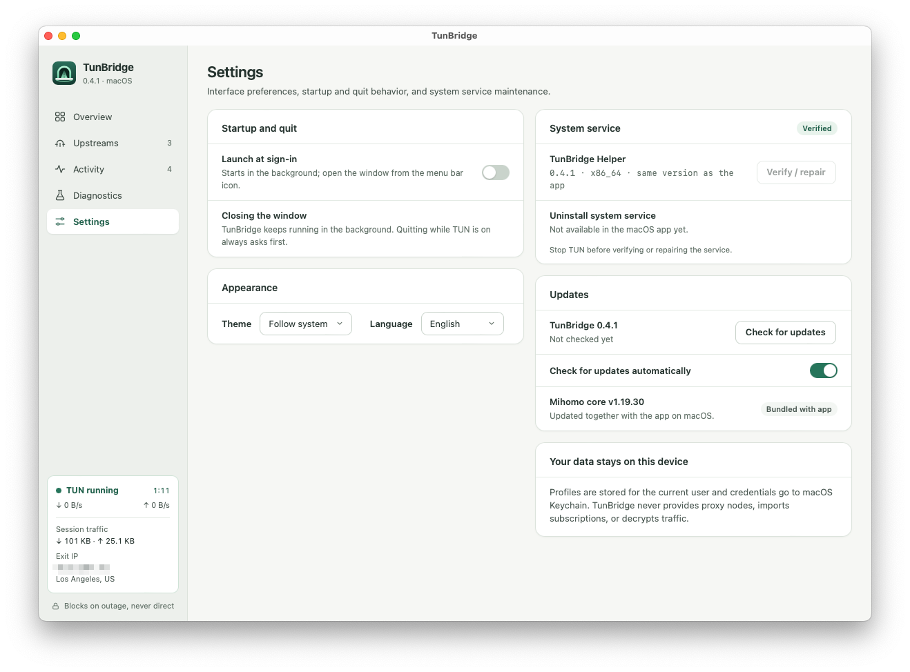
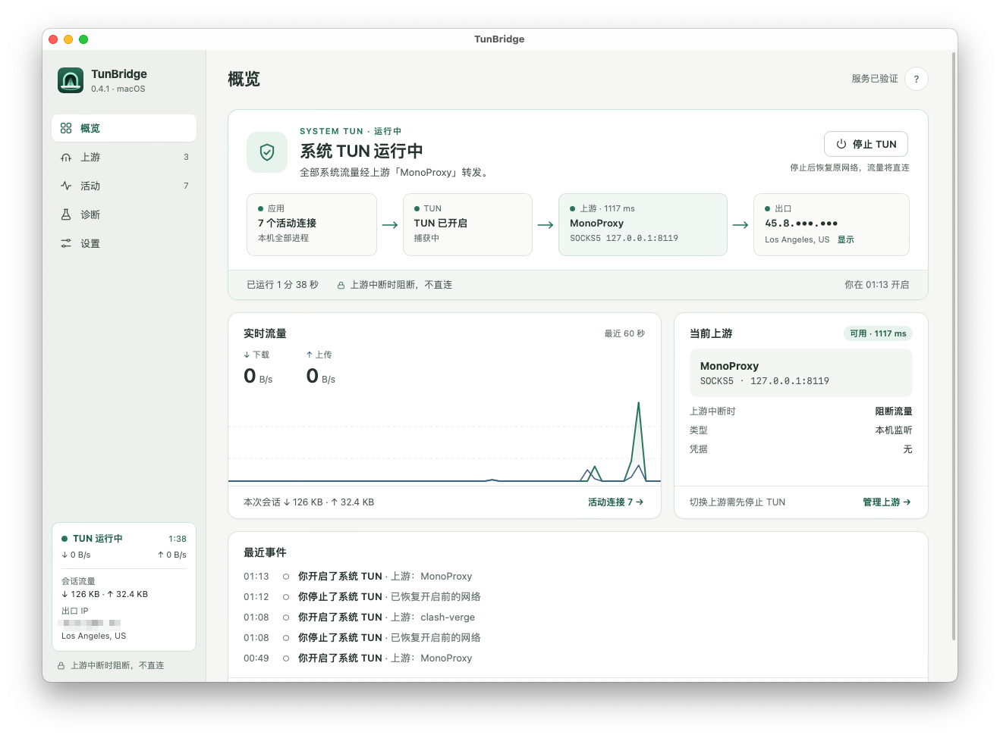
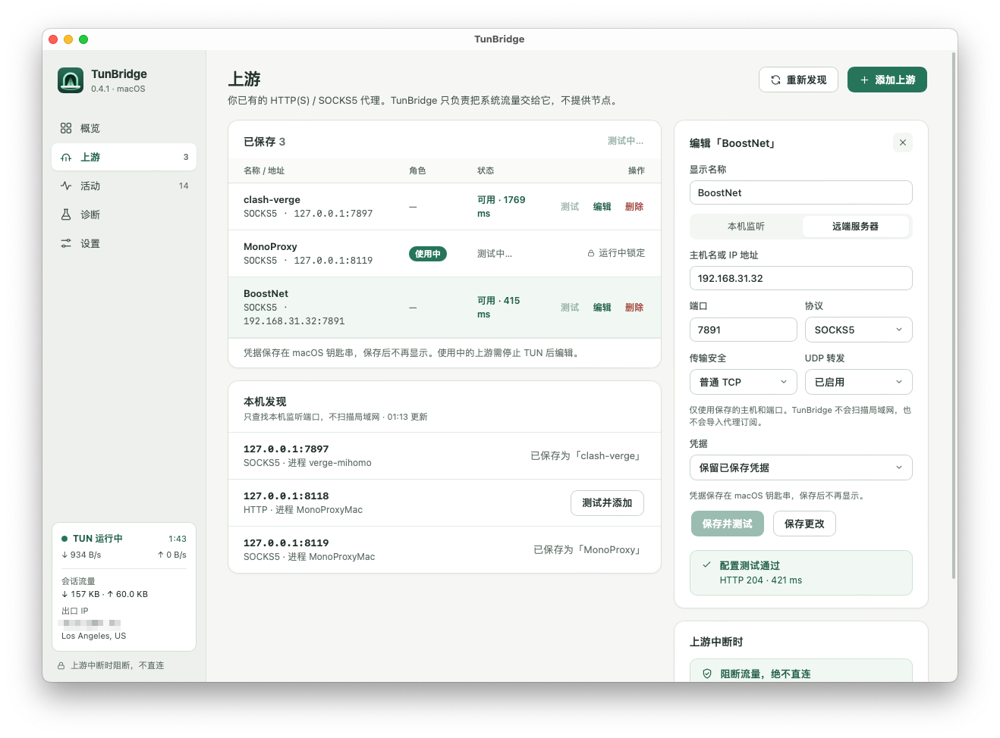
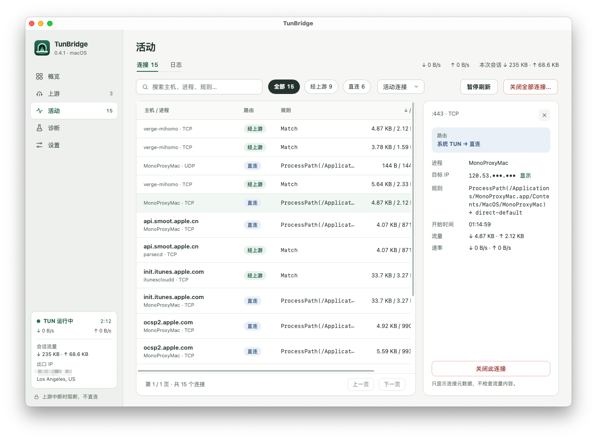
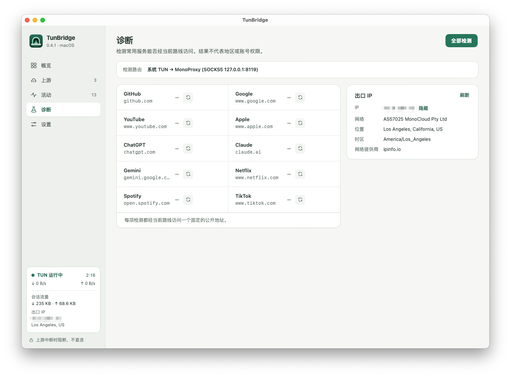
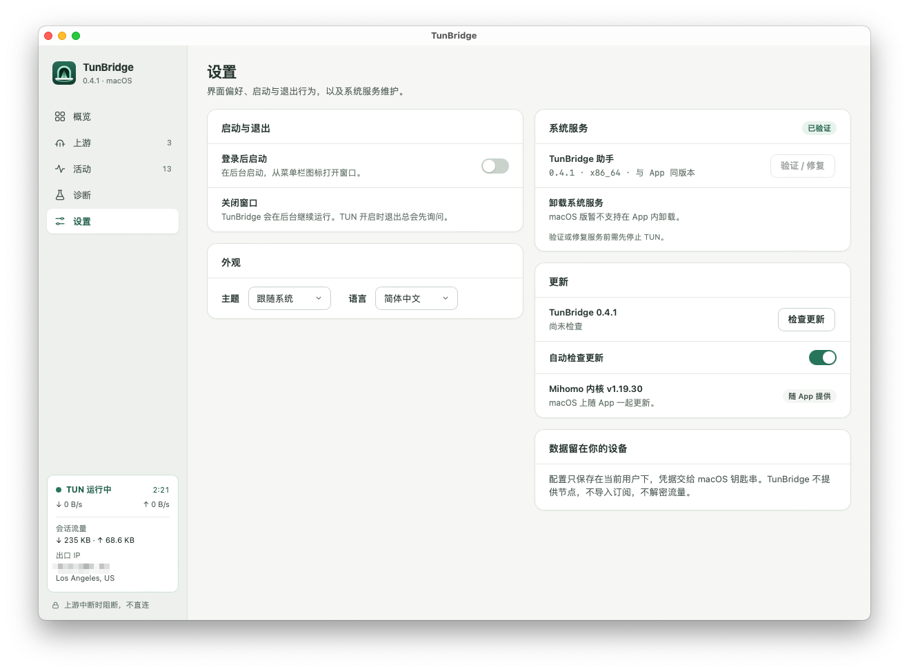

# Screenshots

TunBridge 0.4.1 on macOS with the system TUN running. Exit IP addresses are blurred.

[English](#english) · [中文](#中文)

## English

### Overview

### Upstreams

### Activity

### Diagnostics

### Settings

## 中文

### 概览

### 上游

### 活动

### 诊断

### 设置

